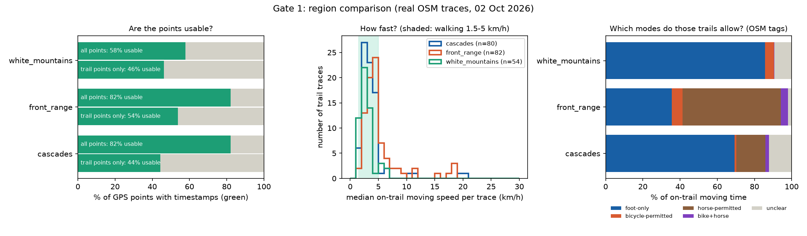
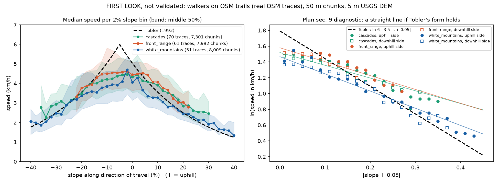

# Meeting prep — weekly sync with Danni & Tianyi

*Written overnight, 2 Oct 2026. About 15 minutes to read. **Part 1 is the
must-read**; the rest is backup to look things up in. A one-page version to
put on screen is in `Meeting_Notes_v3.md`. The plots are collected in
`meeting_plots/`.*

---

## 1. If you only read one thing

**The project in two sentences.** GIS still predicts hiking speed with
Tobler's 1993 formula, which was fit to textbook figures, not to real hikes.
You'll test it on real GPS tracks from OpenStreetMap (OSM), then ask the
remote-sensing question: **can LiDAR and aerial data replace the trail
details that maps usually don't have?** Target: a 4-page paper at **IGARSS
2027, due 11 Jan 2027**.

**Where things stood.** The first checkpoint, *Gate 1: are OSM tracks usable
at all?*, was planned for week 3. Its script existed but had never seen real
data, because the old chat's sandbox couldn't reach OSM. We're in **week 6**
now, about 3 weeks behind. **None of the questions in Meeting_Notes_v2 have
been answered yet** (where the project stands, what's yours, what counts as
"enough", access…), so treat this as your first real project sync. Part 7
has all of them, updated.

**What happened overnight.** Gate 1 now has real answers for all three
candidate regions (4 sample boxes each):

| | White Mountains (NH) | Cascades (WA) | Front Range (CO) |
|---|---|---|---|
| GPS points in the 4 boxes | 536k | 1.46M | 4.48M |
| **Usable** (timestamped), all points | 58% | 82% | 82% |
| **Usable, trail points only** | **~46%** | **~44%** | **~54%** |
| **Hiking traces** (5+ min moving on trails) | **54** | **80** | **82** |
| …from how many people? | 17 named + 26 anonymous | 25 named + 34 anonymous | 19 named + 20 anonymous (one person = 23) |
| Hours of hiking on trails | 254 h | 191 h | 185 h |
| Median on-trail speed | 2.7 km/h | 3.2 km/h | 4.1 km/h |
| Cyclist-speed traces (the "second lobe") | 0 | 4 | 7 |
| Trail time where bikes / horses are allowed | 5% / ~0% | 3% / 17% | 10% / 57% |
| 1 m LiDAR DEM: sample boxes / whole region | 100% / 100% | 56% / 70% | 98% / 100% |
| LiDAR quality | QL2 (2015–18) | QL1 (2016–21); Rainier only 2007–08 | QL1–QL2 (2020) |
| Tree canopy (box average) | **79%** | 46% | 23% |
| `sac_scale` (difficulty) tag on trails | 40% | 55% | 24% |

**The headline: Gate 1 passes, but the dataset will be much smaller than the
plan imagined.**

- It passes because 44–54% of trail points are usable. The fail condition
  ("almost everything comes back scrambled") didn't happen, and on-trail
  speeds sit squarely in the walking range.
- But each region gives **50–80 hiking traces from at most ~40–60
  different people**, not thousands. My rough guess for a full region is **150–400
  traces**. The plan talks about "tens of thousands of hikes", so this is
  *the* thing to discuss.

**Region: it's closer than expected. My lean is the White Mountains, with
the Cascades I-90 corridor a strong alternative.**

- *White Mountains:* the densest forest (what the remote-sensing arm has to
  explain), 100% 1 m LiDAR with no gaps, and the most hours of hiking.
  Weaker points: older and sparser LiDAR (QL2), and foot-only trails.
- *Cascades I-90 (Snoqualmie Pass + Mt Si only):* denser, newer LiDAR (QL1,
  2019–21), more tags, more recent traces. Fewer hiking hours (109 h).
- *Front Range:* the only place where bikes and horses (Question 4) are
  realistic, but there's little forest (23%), so it's a weak test of the
  core question.

**Also raise:** **STRIDE (2024)**, from the Campbell group. It already
predicts walking speed on and off paths from LiDAR, so we must say how we're
different.

**The plots to show** (both in `meeting_plots/`):

1. `region_comparison.png`: the Gate 1 plot.
2. `first_look_slope_speed.png`: a bonus, and the first real slope-vs-speed
   curve. In all three regions, hikers are **~20–30% slower than Tobler at
   their best slope** and slow down **less** on steep slopes. Not validated
   yet.

**What to walk out with:**

1. Where the project stands on the lab side, and what's yours (still open
   from v2).
2. Gate 1 go + a region.
3. What "enough" traces means.
4. How to position against STRIDE.
5. Access requests started: Earth Engine, lab compute and storage, swipe.

---

## 2. Refresher: the project in plain English

**The formula you're testing.** Tobler (1993):
`speed (km/h) = 6 × e^(−3.5 × |slope + 0.05|)`. Slope is rise over run
(10% grade = 0.10), *not degrees*.

| Terrain | Slope | Tobler speed |
|---|---|---|
| Flat | 0 | 5.0 km/h |
| Gentle downhill | −5% | **6.0 km/h (fastest)** |
| 10% uphill | +0.10 | 3.6 km/h |
| 20% downhill | −0.20 | 3.6 km/h (same as 10% up: the asymmetry) |
| 30% uphill | +0.30 | 1.8 km/h |

Other modes are handled by multiplying: ×3/5 off-path, ×5/4 on horseback.

**The four questions** (semester plan §1)

1. **Measurement.** What does slope vs. speed really look like across many real hikes?
2. **The remote-sensing question (the paper's core).** OSM sometimes records a trail's `surface`, `sac_scale` (difficulty) and `width`. Those predict speed, but they're usually missing. *Can LiDAR terrain and vegetation structure stand in for them?*
3. **Asymmetry.** Is the fastest slope really −5%? Uphill and downhill aren't mirror images. Out-and-back hikes are a natural experiment for this.
4. **Mode.** Is a bike or a horse just "walking × a constant", or a different curve? (Stretch goal; depends on trace volume.)

**The four arms** (§4). Every arm predicts the speed on a trail segment. They differ only in what they're allowed to see.

| Arm | Sees | Tells you |
|---|---|---|
| Tobler | slope only, fixed 1993 numbers | the baseline everyone uses |
| Tags | OSM trail tags + slope | the "well-mapped trail" ceiling |
| **Remote sensing** | LiDAR + imagery + slope, **no tags** | **the contribution:** can we predict speed without a map? |
| Both | everything | are tags and remote sensing complementary? |

**Deliverables.** T1 trajectory dataset (most of the work) → T2 covariate stack (LiDAR terrain + vegetation) → T3 four-arm comparison → T4 slope–speed curves. **Core = T1 + T2 + the Tobler comparison.** That is a publishable paper on its own. Everything else is stretch.

**The two gates.** Gate 1 (plan week 3): are the traces usable? Gate 2 (plan week 11): does remote sensing close the gap to the tags?

---

## 3. Timeline: how we got here

| When | What happened |
|---|---|
| 24 Aug 2026 | First in-person meeting with Danni and Tianyi. Danni later scoped the semester plan over Slack/email. |
| 11 Sep | Independent-study form (CSE 5999, 3 units). 2-page project plan submitted to Canvas soon after. |
| ~19 Sep | First meeting notes + the "explained simply" guide (previous Claude chat). |
| ~26 Sep | Previous chat built the Gate 1 kit, **tested on fake data only**: its sandbox couldn't reach OpenStreetMap. Meeting_Notes_v2 written. |
| 27 Sep → 1 Oct | Busy with classes; nothing new. |
| **2 Oct (overnight)** | **Gate 1 run on real data for all three regions.** Script rewritten (v2); LiDAR, relief and canopy checked for every box; first look at slope vs speed. |

**Where that puts you.** Counting 24 Aug as week 1, this is **week 6**. The
plan had Gate 1 in week 3, so you're about **3 weeks behind**. The plan's own
rule: *"If you slip, slip the back."* The fixed points worth protecting are the
gates and the full draft.

**A catch-up schedule to propose** (a starting point, not a promise):

| Week (Mon) | Plan said | Proposed now |
|---|---|---|
| 6 (28 Sep) | T1 | **Gate 1 decision: go + region** |
| 7 (5 Oct) | T1 | T1: download every trace tile for the chosen region; **request Earth Engine + compute access now** |
| 8 (12 Oct) | T2 | T1: stop detection (hand-check ~20 real stops), HMM map-matching |
| 9 (19 Oct) | Tobler baseline | T1: 25–50 m segments, direction + sign test, data card |
| 10–11 (26 Oct–8 Nov) | T3, Gate 2 | T2: 1 m terrain derivatives, canopy, understory from point clouds |
| 12 (9 Nov) | T4 | Tobler baseline + log-linear diagnostic (IGARSS submission site opens 10 Nov) |
| 13–14 (16–29 Nov) | Draft, polish | T3: four arms + gradient-boosted-trees baseline → **Gate 2** |
| 15 (30 Nov) | — | Figures; asymmetry (T4) only if time allows |
| 16 (7 Dec) | — | **Full 4-page draft** |
| Break | Revise, submit | Revise with Danni/Tianyi; submit early January (**deadline 11 Jan 2027**) |

The plan says T1 + T2 + the Tobler comparison is a complete, publishable
paper even if nothing after that lands. In the proposed schedule, that's done
by about week 12.

---

## 4. Gate 1 results in detail

### 4.1 What each number means (plain English)

- **Usable point.** A GPS point with a timestamp. Only *identifiable* and
  *trackable* uploads keep timestamps. *Public* and *private* points come
  back with no time, sorted by latitude, so no speed can be computed from
  them.
- **Usable % (all points).** Usable points ÷ all points in the boxes. This
  is the number plan §6 says "goes in the paper". It counts everything,
  including car loggers on highways.
- **Usable % on trails.** The same, counting only points within 25 m of an
  OSM trail (path, footway, bridleway, steps, cycleway; *not* sidewalks).
  This is the number that matters for hiking. The unusable side is estimated
  from about 6–10 sample pages per box.
- **Hiking trace** (in the code, "trail trace"). A usable trace with at
  least 5 minutes of moving time on trails. This drops drive-throughs and
  parking-lot clips.
- **Outing.** Traces that start within 15 min and 1 km of each other count
  as one outing (two phones on one group hike aren't independent).
- **Named / anonymous.** Identifiable traces show the uploader's OSM name;
  trackable ones don't. So "17 named + 26 anonymous" means *at most* 43
  people, probably fewer.
- **Median on-trail speed.** Per hiking trace, the typical moving speed on
  trails (stops removed with the 0.5 km/h rule), then the median across
  traces.
- **Permitted mode.** From the trail's OSM tags (`bicycle=`, `horse=`, or
  the trail type).
- **1 m coverage, QL.** From USGS: share of the area with a 1 m DEM, and
  the LiDAR quality level (QL1 = 8+ pulses/m², QL2 = 2+). Denser is better
  for understory.

### 4.2 The plot



- **Left:** green = usable. The top bar of each pair counts all points; the
  bottom bar counts trail points only.
- **Middle:** typical hiking speed per trace. The shaded band is walking
  pace.
- **Right:** which modes the trails allow.

Per-region maps and histograms are in `travel-speed-gate1/results/<region>/`.
Each map shows exactly where the usable points are: trails in orange, roads
in gray.

### 4.3 What each region is good and bad at

**White Mountains (NH): my lean**

- ✅ **Densest forest**: 79% canopy over the boxes, 74% right along the
  trails. Plan §7: without forest, *"the vegetation-structure covariates
  have nothing to explain."*
- ✅ **100% 1 m DEM**, both in every box and across the whole White Mountain
  National Forest core. The point clouds can be streamed **free** from the
  USGS public AWS bucket, so T2 can start before any account is approved.
- ✅ **The most hiking hours** (254 h, so long hikes and lots of segments).
  **Real relief** (800–1,400 m per box) and steep trails.
- ✅ **Tags exist but are patchy** (`surface` 58% of trail length,
  `sac_scale` 40%, `width` ~0%). The Tags arm has something to use, and
  there's a real gap to fill.
- ⚠️ **Foot-only** (86% of trail time). **Question 4 is out of scope here.**
  The plan allows that: *"if not, it costs nothing and becomes a limitation
  paragraph."*
- ⚠️ **QL2 LiDAR from 2015–18**, sparser than QL1. Understory metrics will
  be noisier (Campbell et al. 2018). Most hikes are from 2010–2018, so dates
  line up OK.
- ⚠️ **~36% of trail time is in winter** (Dec–Mar). Season must be a
  covariate, or winter must be dropped. (Odd early hint: in 7 winter traces,
  steep descents were *faster*. Maybe packed snow covers the rocks. A tiny
  sample.)

**Cascades (WA): strong alternative if trimmed to the I-90 corridor**

- ✅ The **Snoqualmie Pass + Mt Si** boxes alone have 58 hiking traces (18
  named + 26 anonymous, 109 h), **QL1 LiDAR from 2019–21** with 100% 1 m
  coverage, 51–59% canopy along trails, and the richest tags (`sac_scale`
  55%, `trail_visibility` 32%). Traces are recent: 45% from 2019 or later.
- ❌ The **Rainier box has no 1 m DEM** (only ~3 m from 2007–08), and Cascade
  Pass has 23% coverage and almost no traces. The whole Cascades area is 70%
  covered.
- ⚠️ Only ~10% of usable points are on trails. The rest are car logs on I-90.

**Front Range (CO): best for Question 4, weakest for the core**

- ✅ The only region with a real cyclist "second lobe" (7 traces at 10–19
  km/h) and mostly horse-permitted trails (57% of trail time). Question 4
  could live here.
- ✅ 98–100% 1 m DEM, QL1 in Boulder/Brainard (2020–23).
- ❌ **Little forest** (23% canopy), so it's a weak test of the vegetation
  idea. (The plan: "less canopy, which cuts both ways." GPS is cleaner, but
  there's less to explain.)
- ⚠️ The Boulder and Golden boxes landed on **towns**. Boulder alone has ~3.0M
  points, almost all car logs, plus ~3,500 mapped sidewalks and crosswalks
  (now excluded). Most real hiking is in the RMNP box, where **one person
  uploaded 21 of its 56 hiking traces** (23 of the region's 82).

**If the volume turns out too thin:** pool the White Mountains with the I-90
Cascades. That roughly doubles the hikers and gives a clean "train on one
region, test on the other" split, which plan §10 asks for: *"split by trace
and by geography."* The cost is a second T2 covariate stack.

### 4.4 Data surprises worth knowing

- **Car-logging software uploads to OSM.** *sunnypilot* and *dragonpilot*
  are driver-assistance programs. They make up most "identifiable" traces in
  the Cascades and Front Range: hundreds of traces from a handful of
  accounts. They're on roads, so the trail matching removes them.
- **Hikers mostly choose "public" uploads.** In the White Mountains, 82% of
  the *unusable* points lie on trails, against 52% of the usable ones. That's
  why "usable on trails" (~46%) is lower than "usable overall" (58%).
- **One person can dominate**: 21 of 56 RMNP hiking traces come from one
  uploader. Count people, not just traces.
- **Duplicates and group hikes are real**: 2–10 duplicate uploads per region
  were dropped; outings are counted separately.
- **Clock bugs**: a few traces claim dates like 1970 or 1987 (old GPS
  firmware). Day-of-year covariates need a sanity filter.
- **Stops**: on trails, the crude 0.5 km/h rule removes 13–20% of time, and
  the draft "60 s, < 10 m" rule removes 15–24%. The two disagree on which
  minutes are stops. *T1 needs a validated rule* (plan §8: this choice "will
  move your headline numbers more than any model change").
- **GPS wobble is small on real data**: about +2–3% speed inflation for 43
  walkers recorded every 1–2 s (White Mountains + Front Range). The fake test
  (+168%) wildly exaggerated it, as the old notes predicted.

### 4.5 Bonus: first look at slope vs. speed (not validated)



Built from ~23,000 chunks of ~50 m, from 182 walker traces in the three
regions. Speed and slope are measured over each chunk; elevation comes from a
5 m USGS DEM; an automatic test checks that "uphill = positive".

| Fit of `ln v = ln v0 − k·abs(s + s0)` | v0 (peak speed) | k (how fast speed drops with slope) | fastest slope |
|---|---|---|---|
| **Tobler 1993** | **6.0 km/h** | **3.5** | **−5%** |
| White Mountains | 4.3 | 2.2 | −5.0% |
| Cascades | 4.6 | 1.6 | −4.0% |
| Front Range | 4.9 | 1.8 | −5.5% |

**What it suggests:**

1. Real hikers are ~20–30% slower than Tobler on gentle terrain.
2. Their speed drops *less* on steep slopes; on very steep slopes they're
   close to Tobler.
3. The fastest slope sits near −5% in all three regions, as Tobler says,
   though in the Front Range the top of the curve is more of a flat plateau
   than a peak.
4. The White Mountains curve is the slowest at almost every slope. That's a
   region effect that terrain and vegetation should explain, which is
   Question 2 in a nutshell.

**Caveats (say these first):**

- Crude snapping to trails, not real map-matching.
- Speed over the GPS path, not fixed trail segments.
- Noise in the measured slopes *by itself* flattens a fitted curve (lower
  k). Some of the "less slope-sensitive" result could be measurement error.
  T1's clean segments will tell.
- The uploader population skews toward keen mappers (plan §8).

### 4.6 What tonight teaches us about T1 (the dataset)

- **Read every usable page.** The newest uploads come first, and they're
  often car loggers. Hiking traces are older and sit deeper.
- **Get whole hikes for identifiable traces.** For any identifiable trace,
  `openstreetmap.org/trace/<id>/data` serves the **original full GPX** with
  no login. That's the whole hike (not just the part inside a box), the
  original sampling, elevation and the recording app's name. Tested on one
  trace: it works. Trackable traces only exist as box-clipped pieces, so
  those have to be stitched by time.
- **Drop cars and sidewalks**: by road matching, and by the openpilot user
  names.
- **Count independence honestly**: traces, outings and uploaders.
- **Size of the job**: the full White Mountains at 0.25° tiles is about 12
  tiles and roughly 1,000–2,000 pages. That's a few hours (overnight) at the
  polite rate, and it's cached, so it only happens once.

---

## 5. What broke (the "what broke" part of the meeting)

Running on real data broke the old script in ways the fake-data test couldn't
reveal. All of these are fixed. The fake-data self-test now also checks the
first three, plus duplicates and split traces (`selftest.py`, 29 checks, all
pass).

1. **Paging bias (the big one).** The OSM API sends every *usable* point
   first and all the unusable ones after. The old script stopped after 10
   pages, so in a busy box it only ever saw usable points. It would have
   reported **~100% usable**. Mt Washington is really **60%**. Now the script
   finds where the unusable points start, then jumps ahead to count them.
2. **Multi-hike uploads thrown away.** One hiker uploaded a whole winter
   (several hikes, Jan–Mar 2019) as one file, stored out of date order. The
   old script saw time "go backwards" and called it shuffled. Now each
   recording is checked on its own.
3. **Cars read at walking speed.** Car loggers record 10 points per second
   but store whole seconds only. The old script dropped the "zero-time" pairs
   and read a 40 km/h car at ~7 km/h. Now it keeps one point per second.
4. **Car loggers swamping the sample.** Because the newest uploads come
   first, a 40-page sample was mostly car logs. Fix: read up to 150 pages,
   and report **usable share on trails**, which cars can't inflate. (Boulder
   still hits the cap: ~500 pages of usable points, almost all car logs.)
5. **Sidewalks counted as trails.** Cities map sidewalks and crosswalks as
   footways, so car points snapped to them. Now excluded.
6. **My first LiDAR check had a units bug**: degrees read as meters. Fixed.
   That's how we learned **the Rainier box has no 1 m DEM at all**.
7. **Public servers are flaky at night.** The OSM trail server (Overpass) and
   USGS often said "too busy". Added retries, backup servers, and asking for
   big boxes in 16 small pieces. Everything is cached, so nothing is
   downloaded twice.

---

## 6. Meeting script (about 5 minutes)

> **Opener (honest, short):** "I fell behind for a couple of weeks with
> classes, so Gate 1 is late. But this week I ran it for real on all three
> candidate regions, with Claude's help, so I have actual numbers."
>
> **1. What I did.** "Four sample boxes per region. About half the GPS points
> on trails are usable: 44–54% depending on the region. On-trail speeds are
> walking-pace. I also checked 1 m LiDAR coverage, quality level, relief and
> canopy for every box." → *show `region_comparison.png`*
>
> **2. What broke.** "Real data broke the script in ways fake data couldn't.
> The old version would have said ~100% usable because of how the API pages
> results, and it threw away multi-hike uploads. Both are fixed and tested.
> Also, most 'identifiable' traces in two regions are car logs from
> driver-assistance software, so I report the usable share on trails too."
>
> **3. One plot.** "A first rough slope-vs-speed curve from 182 hikes. It's
> not validated, but in all three regions hikers are ~20–30% slower than
> Tobler on gentle slopes and close to him on steep ones." → *show
> `first_look_slope_speed.png`*
>
> **4. What I need from you.** "First, the questions from last time: where
> the project stands on your side, and what's mine to own. Then a Gate 1
> decision and a region: I lean White Mountains, with the I-90 Cascades as
> the alternative. Whether 50–80 hikes per region, maybe a few hundred in a
> full region, is enough. And how to position against STRIDE."

---

## 7. Questions to ask, most important first

**The 7 questions from Meeting_Notes_v2 are all still open.** Here's where
each one went:

| v2 question | Status now | Below |
|---|---|---|
| 1. Where does the project stand? Has Gate 1 been done, and which region? | Gate 1 is now done on real data. Still ask whether the lab already has related work, and get the region decision. | Q1, Q2 |
| 2. What's mine to pick up this week? | Still open | Q1 |
| 3. What counts as "enough" usable traces? | Still open, now with real numbers | Q3 |
| 4. Have you seen Cutler et al. (2026)? | Still open; add STRIDE (2024) | Q4 |
| 5. Is RasterNet's code available in the lab? | Still open; no public repo found | Q8 |
| 6. Is there a standard Python environment? | Still open (I set up a local one in `.venv` meanwhile) | Q7 |
| 7. Process for Earth Engine, compute, swipe? | Still open | Q5 + Part 9 |

**Must ask**

1. **Where does the project stand on the lab side, and what's mine?** (Open
   since v2.) Has anyone in the lab already worked on this: a trace dataset,
   a region choice, a Gate 1 run, or the off-road travel-time model the plan
   says this feeds? I don't want to duplicate work, and the dataset should
   fit what that downstream work needs. Is the whole pipeline (T1 → T3) mine?
2. **Gate 1: go? Which region?** White Mountains (my lean), Cascades I-90,
   or both pooled? (Trade-offs in Part 4.3.)
3. **Is "a few hundred hikes" enough?** In the sample boxes there are 50–80
   hiking traces per region, from at most ~40–60 people. The full region
   might give 150–400. The plan imagined tens of thousands. Is that enough
   for the four-arm comparison, or should we pool regions, widen the region,
   or add another trace source?
4. **STRIDE (2024) and Cutler et al. (2026).** The same Utah group
   (Campbell, Cutler, Dennison) already predicts walking speed from LiDAR
   slope + vegetation + roughness. STRIDE covers on- AND off-path, calibrated
   on three field experiments. Cutler 2026 is off-trail with a random forest
   (R² ≈ 0.78). From the abstracts, neither uses crowdsourced hikes or
   compares against map tags (worth confirming in the full papers). *How
   should we position? Should STRIDE be a baseline arm next to Tobler?*
5. **Access, now:** Earth Engine, lab compute + storage, swipe. What's the
   process for each? (See the checklist in Part 9.)

**Good to ask**

6. **Question 4 (mode).** OK to drop bikes/horses to a limitations paragraph
   if we pick the White Mountains? Or does mode matter enough to choose the
   Front Range?
7. **Lab conventions.** Is there a lab GitHub org for the pipeline (the plan
   says commit the pipeline)? A standard Python environment? Shared storage
   for the downloaded data?
8. **RasterNet code.** The project page links only to the first author's
   GitHub profile; I couldn't find a public RasterNet repo. Does the lab have
   it?
9. **Canvas milestones.** When are the progress updates, paper reviews and
   final report due?

---

## 8. If they ask… (cheat sheet)

| They ask | You say |
|---|---|
| "How do you decide a point is usable?" | It has a timestamp. OSM only gives timestamps for *identifiable* and *trackable* uploads; *public* and *private* points come back without time, sorted by latitude. |
| "Why count points, not traces?" | The API lumps all untimed points on a page into one nameless track, so untimed traces can't be counted, only their points. |
| "How do you know a point is on a trail?" | Nearest OSM path within 25 m (sidewalks excluded). That's crude, a stand-in for HMM map-matching (a T1 job). |
| "What's 'usable on trails'?" | Usable trail points ÷ all trail points. The unusable side is estimated from a sample of pages spread across each box. |
| "How many independent hikes?" | Trace ≠ hike ≠ person. We count traces, "outings" (traces that start together = one group hike) and distinct uploaders. One person can upload 23 traces. |
| "Why speed over 10-s steps?" | GPS wobble inflates point-to-point speed at 1–2 s recording. On real data it's small (+2–3%), but 10-s steps make all traces comparable. T1 will use 25–50 m segments. |
| "What are QL1/QL2?" | LiDAR quality levels: QL1 = 8+ pulses/m², QL2 = 2+. Denser is better for understory metrics (Campbell et al. 2018). White Mountains = QL2; Cascades I-90 = QL1. |
| "Is 1 m everywhere?" | No. 100% in the White Mountains and the Front Range. The Rainier box is 0% (only ~3 m from 2007–08), Cascade Pass 23%, the whole Cascades area 70%. |
| "Isn't winter a problem?" | Yes: ~36% of White Mountains trail time is Dec–Mar. Season goes in as a covariate (day of year, sin/cos), as plan §7 says, or we keep snow-free months only. |
| "Is the slope curve real?" | First look only: snapping to the nearest trail, a 5 m DEM, 50 m chunks along the GPS path, walkers only (median ≤ 7 km/h). The sign convention has an automatic test. Slope noise alone would flatten the curve, so T4 waits for T1's clean segments. |
| "Couldn't you get whole hikes?" | Yes, for identifiable traces: the original GPX downloads from `openstreetmap.org/trace/<id>/data` with no login (tested). Trackable traces exist only as pieces. |

---

## 9. Next 2 weeks + access checklist

| Week | Do | Output |
|---|---|---|
| This week (6–7) | Gate 1 decision. Send the access requests below. Read the 4 core papers in full (left over from the v2 plan), plus STRIDE + Cutler 2026 (and Newson & Krumm for map-matching). | Go + region; access requested |
| Next week (7–8) | T1 start: download every trace tile for the chosen region, plus full GPX files for its identifiable traces. Hand-check ~20 real stops to tune the stop rule. Try `leuvenmapmatching` on 5 traces. | Full trace set + data card draft; a stop-rule plot |

**Access checklist.** These need **your** accounts, so I can't do them for
you. Each takes about 5 minutes to start.

1. **Google Earth Engine** (3DEP, NAIP imagery, NLCD canopy, AlphaEarth
   embeddings). Register at `code.earthengine.google.com/register`. Choose
   unpaid / academic research use, then pick or create a Google Cloud
   project. **Ask Danni/Tianyi first whether the lab already has a Cloud
   project you should join.**
2. **Lab compute + storage**: ask who runs the lab machines and what to
   request. The data so far is ~0.6 GB, but T2 point clouds will be bigger.
3. **Swipe access**: depends on your CSE 5999 paperwork (form dated 11 Sep).
   Ask whether it has been processed.
4. **LiDAR point clouds need no account**: the USGS 3DEP point clouds (e.g.
   NH_Umbagog_2016 for the White Mountains) are in the public
   `usgs-lidar-public` AWS bucket, which PDAL can read directly.
   OpenTopography is optional.

---

## 10. Where everything is

| File | What |
|---|---|
| `Meeting_Prep_Brief.md` | this file |
| `Meeting_Notes_v3.md` | 1-page version to put on screen (replaces v2) |
| `meeting_plots/` | the plots to show, all in one place |
| `DECISIONS_LOG.md` | every threshold used so far (plan §15) |
| `travel-speed-gate1/results/` | all results: `region_comparison.*`, `region_layers.csv`, `first_look_*`, one folder per region (summary, trace table, histograms, map) |
| `travel-speed-gate1/README.md` | how the scripts work, in plain English |
| `travel-speed-gate1/*.py` | the code: `gate1_audit.py`, `region_layers.py`, `first_look_slope.py`, `selftest.py` |
| `travel-speed-gate1/cache/` | every download (~0.6 GB). Don't delete: it saves the servers and makes re-runs instant |
| `travel-speed-gate1/archive/` | version 1 of the scripts |
| top-level `README.md`, `Meeting_Notes_v2.md`, `reading_notes.md` | copies from the old chat (the v1 README is outdated; see the one in `travel-speed-gate1/`) |

To re-run everything from the cache (about 5 minutes, no downloading):

```bash
cd ~/Desktop/GeoAI/travel-speed-gate1 && ../.venv/bin/python gate1_audit.py --region all --offline
```

---

## 11. Glossary (30 seconds)

- **OSM**: OpenStreetMap, the open map. Source of both the GPS traces and the trail tags.
- **Trace / trackpoint**: an uploaded GPS recording / one GPS point in it.
- **identifiable / trackable / public / private**: the uploader's privacy choice. Only the first two keep timestamps.
- **Tags**: map labels on a trail, such as `surface=ground`, `sac_scale=mountain_hiking` (difficulty), `width=1`.
- **LiDAR**: laser scanning from aircraft. It gives 1 m ground shape *and* vegetation structure.
- **3DEP**: the US program that collects LiDAR and makes the 1 m DEMs (Digital Elevation Models).
- **QL1/QL2**: LiDAR quality levels (pulse density 8+ vs 2+ per m²).
- **Map-matching**: snapping noisy GPS points onto the trail network (properly done with an HMM; Newson & Krumm 2009).
- **Heteroscedastic head**: the model predicts a speed *and* how uncertain it is.
- **STRIDE**: the Campbell group's 2024 LiDAR-based walking-speed model (*Scientific Reports* 14:21393).
- **IGARSS**: the target conference (IEEE remote sensing), Reykjavík, 11–16 July 2027; 4-page papers due 11 Jan 2027.

**Sources checked tonight:** [IGARSS 2027 dates](https://2027.ieeeigarss.org/important_dates.php) ·
[STRIDE, Sci. Reports 2024](https://www.nature.com/articles/s41598-024-71359-6) ·
[Cutler et al. 2026, GIScience & RS](https://doi.org/10.1080/15481603.2026.2626632) ·
[RasterNet paper (CVPRW 2020)](https://openaccess.thecvf.com/content_CVPRW_2020/html/w11/Hadzic_RasterNet_Modeling_Free-Flow_Speed_Using_LiDAR_and_Overhead_Imagery_CVPRW_2020_paper.html)
